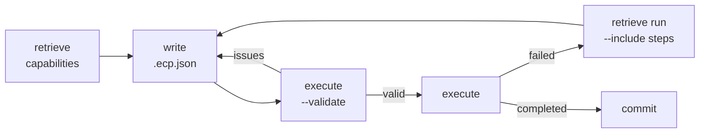

ECP (Execution Control Protocol) is built for an agent that writes its own executions and fixes them from structured feedback. This page walks through that loop with the CLI. Over MCP, the steps are the same calls to the `retrieve`, `execute`, and `commit` tools.



## Retrieve

Start from what is installed, not from memory. Search capabilities by intent:

```bash
ecp retrieve --type capability --query csv
```

```text
id                                        plugin                          summary
@executioncontrolprotocol/core.parse-csv  @executioncontrolprotocol/core  Parse a CSV file into rows.
```

Then read one capability in full. The `accepts` and `returns` schemas are exactly what validation checks against:

```bash
ecp retrieve --type capability --id @executioncontrolprotocol/core.parse-csv
```

Search is deterministic keyword matching on ids, summaries, and use cases, so short concrete words work best. Also useful:

| Command | Shows |
| ------- | ----- |
| `ecp retrieve --type execution` | Saved executions |
| `ecp retrieve --type config` | Stored config objects (secret references only) |
| `ecp plugins` | Installed plugins and whether their manifests loaded |
| `ecp retrieve --type schema` | The path of the editor JSON Schema for `*.ecp.json` files |

If a capability you need belongs to a first-party plugin that isn't installed, validation tells you with `ECP_PLUGINS_MISSING` and the exact `ecp plugins install` command.

## Write

Write the execution as a `*.ecp.json` file. Keep it small to start: one or two steps, then grow it. Pointing `$schema` at the editor schema gives you autocomplete in most editors:

```bash
ecp retrieve --type schema
```

```text
/home/you/.ecp/schema/execution.schema.json
```

See [Execution manifest](/guides/executions) for every field.

## Validate

```bash
ecp execute flow.ecp.json --validate
```

Validation runs in layers. Each layer runs only when the earlier ones pass, so you fix problems in a sensible order:

| Layer | Checks |
| ----- | ------ |
| Load | The file exists, parses as JSON, and has the right `schema` and `version` |
| Schema | Node shapes, marker syntax, each step's `input` against its capability's `accepts`, unknown capability ids |
| Semantics | Unique ids, branch default arm last, loop fields per mode, `expr` and script syntax, transform contracts, config ids, no secrets |
| Data flow | Every `$ref` points at something produced earlier, the path exists in the producer's `returns`, types fit, maybe-missing values are handled, no write conflicts |
| Run input | The `--input` you pass against `execution.accepts` |

Every issue has a `code`, a JSON Pointer `path` into your file, a one-sentence `message`, and often `suggestions` or a list of `available` state paths:

```text
ECP_MANIFEST_INVALID  1 validation error
/steps/1/uses  ECP_CAPABILITY_UNKNOWN  Capability @executioncontrolprotocol/test.ech is not installed.
  suggestion: did you mean '@executioncontrolprotocol/test.echo'?
```

With `--json`, the same issues come back as data an agent can act on:

```json
{
  "ok": false,
  "error": {
    "code": "ECP_MANIFEST_INVALID",
    "message": "The execution is invalid.",
    "path": "/steps/1/uses",
    "issues": [
      {
        "code": "ECP_CAPABILITY_UNKNOWN",
        "severity": "error",
        "message": "Capability @executioncontrolprotocol/test.ech is not installed.",
        "path": "/steps/1/uses",
        "suggestions": ["did you mean '@executioncontrolprotocol/test.echo'?"],
        "actual": "@executioncontrolprotocol/test.ech"
      }
    ]
  }
}
```

Fix, validate again, and repeat until the result is `valid` (exit code `0`). Validation never creates a run, so it's free to call often.

## Run

```bash
ecp execute flow.ecp.json --input '{"titles": ["One", "Two"]}'
ecp execute flow.ecp.json --input @input.json
cat input.json | ecp execute flow.ecp.json --input -
```

The CLI prints one line per step and then the result. A run that fails exits with code `1` and shows the failed step's error; validation problems exit with `2`. See [Error codes](/reference/error-codes).

Long runs don't have to block:

```bash
ecp execute flow.ecp.json --no-wait --json        # returns { runId, status: "running" }
ecp retrieve --type run --id <runId>              # poll
ecp execute --cancel <runId>                      # stop it
```

To try a change to a saved execution without saving it, run it with a patch. See [Operations](/reference/operations#patch-format).

## Inspect

Every run has a record with each step's resolved input, output, duration, and error:

```bash
ecp retrieve --type run --id <runId> --include steps
ecp retrieve --type run --id <runId> --include events,state
```

A failed step's error carries its `nodeId` and `path`, and, for provider failures, the upstream HTTP status and response body. That is usually enough to fix the execution without reading logs. If the host restarted mid-run, the run is `interrupted`; continue it with `ecp execute --resume <runId>`.

## Commit

Once an execution works, save it so it can be reused by id:

```bash
ecp commit --type execution --action create --object @flow.ecp.json
ecp execute my-flow --input @input.json
```

The execution needs an `execution.id`. Updates and deletes need `--if-version` so two agents can't overwrite each other's work:

```bash
ecp commit --type execution --action update --id my-flow --object @flow.ecp.json --if-version 1
```

A stale version fails with `ECP_VERSION_CONFLICT` and names the current one.

## Tips for agents

- Read `accepts` and `returns` before writing a step; don't guess field names.
- Prefer file paths over inline manifests: errors point at real lines, and relative `script.path` files resolve.
- Use `--out <file>` (or `output.path` over MCP) for large results, and read the file instead of the console.
- Keep `expr` for control and use [transform steps](/guides/transforms-and-scripts) for reshaping data.
- Never put secret values in an execution or in run input. Ask the user to run `ecp config secrets set`.

## Next steps

- [Execution manifest](/guides/executions)
- [Control flow](/guides/control-flow)
- [Error codes](/reference/error-codes)
