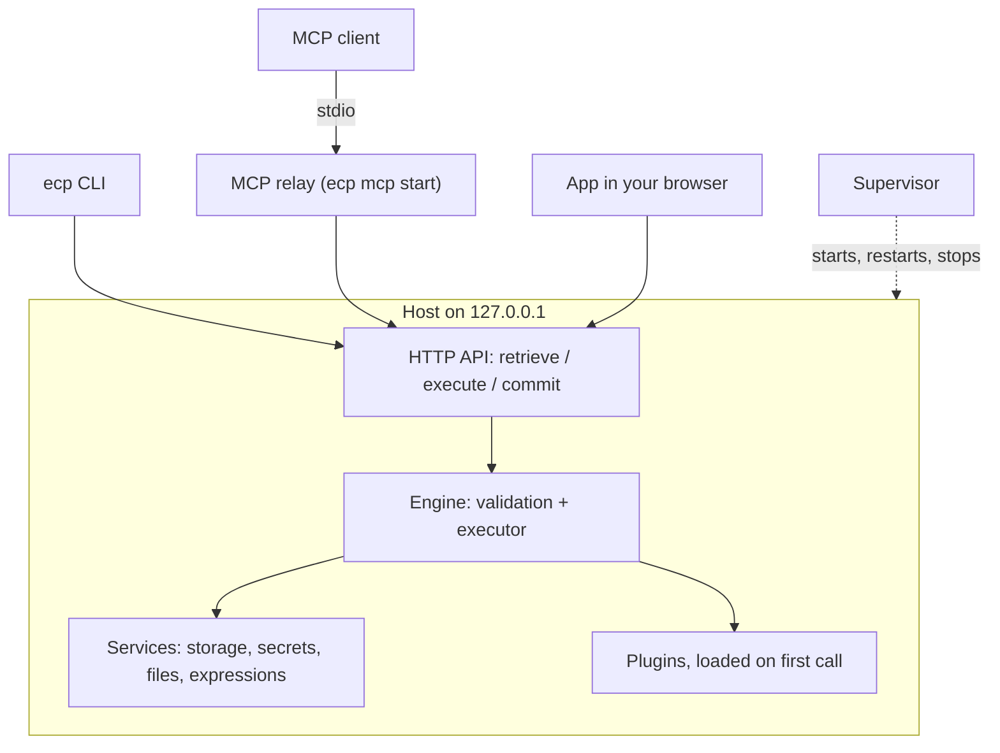

ECP (Execution Control Protocol) runs on your machine as one **host** process. Every client, whether the CLI, an MCP client, or the App, talks to that host through the same three operations. This page explains the pieces and how a request flows through them.

## The big picture

## Host

The host holds the engine, the plugin registry, storage, and the HTTP API. It:

- Binds `127.0.0.1` only, on a random free port.
- Requires a random bearer token on every API call and rejects unexpected `Host` and `Origin` headers, which blocks DNS-rebinding attacks from web pages.
- Builds its capability registry from plugin manifests without importing plugin code. A plugin's code loads on the first call to one of its capabilities.
- Writes editor schemas to `$ECP_HOME/schema/` so editors can autocomplete `*.ecp.json` files.

## Supervisor

A small supervisor process owns the host's lifecycle:

- **Start on demand.** The first `ecp retrieve`, `execute`, `commit`, or `plugins` call starts it if no healthy host exists, and prints `host: started http://127.0.0.1:<port> (idle 15m)` once.
- **Restart on plugin changes.** Installing, linking, or removing a plugin touches a marker file. The supervisor drains the host (lets running runs finish, up to 30 seconds) and starts a fresh one on the same port and token.
- **Restart on crash** with backoff. After repeated crashes it stops and reports `ECP_HOST_UNAVAILABLE` with log paths.
- **Stop when idle.** After 15 minutes with no requests, no active runs, and no open App streams, it stops cleanly.

The port, token, and process ids live in `$ECP_HOME/host.json` (readable only by you). See [Run the host](/guides/host).

## Clients

| Client | How it reaches the host |
| ------ | ----------------------- |
| **CLI** | Reads `host.json`, calls the HTTP API. With `--no-start-host`, it can also run the operation in-process without a background host. |
| **MCP relay** | `ecp mcp start` is a stdio MCP server with three tools that forward to the host API. It starts the host if needed and retries through restarts. |
| **App** | A web UI served by the host at `/app/`. `ecp app` opens it with the token in the URL fragment. |
| **Your code** | Any HTTP client on the same machine can call `POST /v1/retrieve`, `/v1/execute`, and `/v1/commit` with the token from `host.json`. |

Because every surface uses the same operations and the same validation, an error looks the same whether the CLI, an agent, or the App hit it.

## Engine

The engine has two halves:

- **Validation** runs in layers: load, schema, semantics, data flow, and run input. Later layers run only when earlier ones pass, so issues are precise. See [The agent loop](/guides/agent-loop#validate).
- **The executor** walks the graph, resolves `$ref` bindings from state, resolves config and secrets, calls capabilities, validates their output, and commits it to state. State is saved after every step, so an interrupted run can resume.

## Services

Every part of the host that touches the outside world is a **service** behind an interface: plugin loading, storage, artifact storage, scratch space, secrets, the expression engine, formatters, the HTTP endpoint, and auth. The local host wires in the local implementations: files under `$ECP_HOME`, the OS keychain, and QuickJS for expressions and scripts.

The engine and plugins only see the interfaces, so another deployment can swap an implementation, for example object storage for run artifacts, without changing executions or plugins.

## Plugins

Plugins provide capabilities only. Formatting, storage, secrets, and auth are host services, not plugins. Each plugin ships:

- `ecp.manifest.json`: a light index of its capabilities with summaries for agents.
- `ecp.schema.json`: the JSON Schemas for every capability's `accepts` and `returns` and the plugin's config.
- Handler code, loaded lazily.

See [Write a plugin](/guides/writing-a-plugin).

## Where things live

Everything ECP stores is under `$ECP_HOME` (default `~/.ecp`): the host file, logs, installed plugins, saved executions and configs, run records, and editor schemas. See [Run records](/reference/run-records) for the layout.

## Next steps

- [Run the host](/guides/host)
- [Connect over MCP](/guides/mcp)
- [Operations](/reference/operations)
